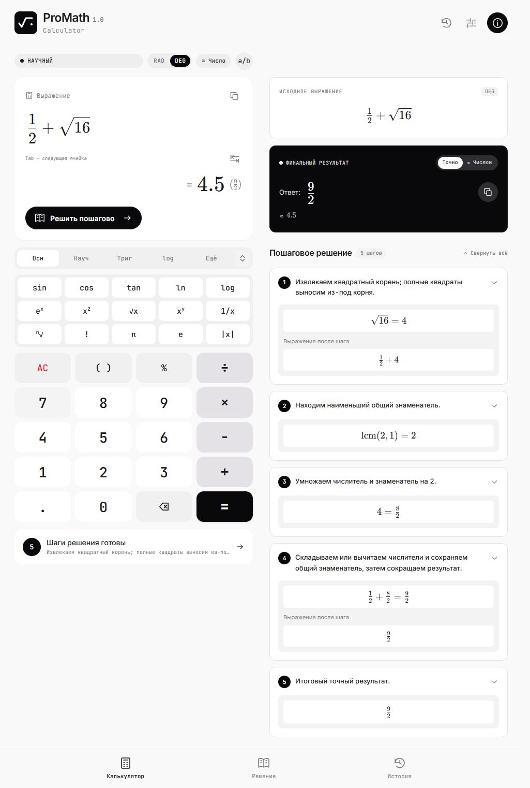
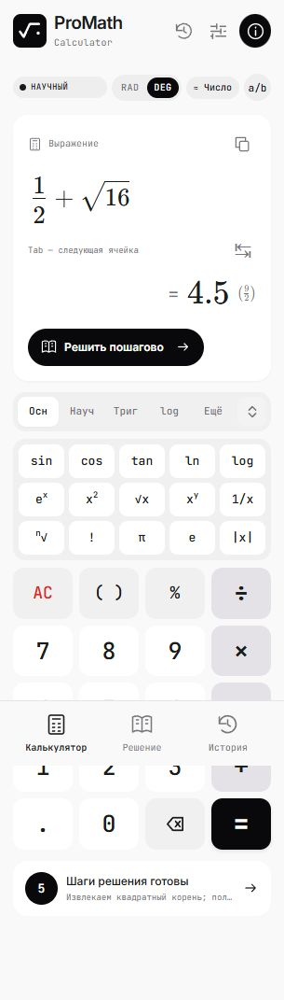
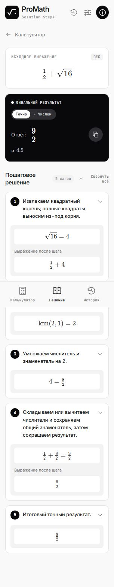
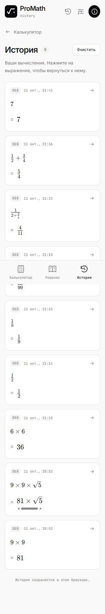

# ProMath

**Научный калькулятор с красивым вводом формул и объяснением решения.** Работает полностью в браузере: без сервера, регистрации и передачи выражений куда-либо.



ProMath понимает дроби, корни, степени, функции и неизвестные `a`–`z`. Он строит дерево выражения (AST), вычисляет операции собственным математическим движком и показывает ход решения. Пользовательский ввод не исполняется как JavaScript.

## Быстрый запуск

Нужны **Node.js 22.12+** и npm.

```bash
npm install
npm run dev
```

Откройте адрес, который покажет Vite. Для проверки и сборки:

```bash
npm run test       # тесты Vitest
npm run typecheck  # проверка TypeScript
npm run build      # готовый сайт в dist/
npm run preview    # просмотр собранного сайта
```

## Что умеет калькулятор

- **Точный ответ и приближение.** Десятичные числа сначала переводятся в дроби на `bigint`: `0.1 + 0.2` даёт точно `3/10`. Иррациональные ответы, например `√2`, сохраняют математическую форму.
- **Пошаговое решение.** Шаги строятся из AST и выполненных операций. Для `1/2 + 1/3` показывается приведение к общему знаменателю и ответ `5/6`.
- **Визуальный редактор.** Дробь, корень, степень и основание логарифма имеют отдельные редактируемые ячейки. Можно вводить с физической или экранной клавиатуры, перемещать курсор и вставлять функции в нужное место.
- **Научные функции.** Степени, корни, факториал, модуль, логарифмы, тригонометрия с режимами DEG/RAD, сочетания, размещения, НОД, НОК и проценты.
- **Неизвестные `a`–`z`.** Например, `2x + 3x → 5x` и `x/2 + x/3 → 5x/6`. Можно оставить буквенный ответ или задать значения букв и получить числовой результат с шагом подстановки.
- **История и оформление.** История и настройки хранятся локально в браузере. Интерфейс работает на телефоне и компьютере, есть светлая и тёмная темы.

| Ввод | Ответ |
| --- | --- |
| `2 + 3*sqrt(16)` | `14` |
| `2^3^2` | `512` — степени вычисляются справа налево |
| `1/2 + 1/3` | `5/6` |
| `sqrt(2)` | точный `√2` и приблизительный `1.4142135624` |
| `sin(30)` в DEG | `1/2` |
| `gcd(12,18)`, `lcm(12,18)` | `6`, `36` |
| `500 + 20%` | `600` |
| `2x + 3x` | `5x` |

### Как вводить выражения

Нажимайте экранные клавиши или печатайте формулу прямо в поле. Кнопка **÷** создаёт дробь с ячейками числителя и знаменателя; **√**, **xʸ** и **logₓ** вставляют соответствующие шаблоны. **Tab** и кнопка **↹** переходят к следующей ячейке. **Enter** или **=** вычисляют выражение, **Escape** очищает поле. Работают Backspace, Delete, стрелки и выделение.

Текстовый синтаксис поддерживает `+ - * / ^ ! %`, скобки `() [] {}`, числа вроде `1.2e-5`, константы `pi`/`π` и `e`. Умножение можно опускать: `2x`, `2(3+4)`, `3sin(2)`. Основные имена функций: `sqrt`, `cbrt`, `root`, `abs`, `log`, `ln`, `sin`, `cos`, `tan`, `cot`, `asin`, `acos`, `atan`, `nCr`, `nPr`, `gcd`, `lcm`. Например, `root(81,4)` даёт `3`, а `log(8,2)` — `3`.

Буквы во **визуальном поле** означают неизвестные. В текстовом синтаксисе `e` означает число Эйлера; для неизвестной `e` используйте `var(e)` или клавишу `e` в категории **a–z**. Для числовой подстановки заполните поля, появляющиеся под выражением. Значением может быть число, дробь или выражение без неизвестных, например `1/2` или `sqrt(2)`.

Поддерживаемый LaTeX тоже можно вставить в поле, например `\frac{1}{2}+\sqrt{16}`. Редактор принимает только известные математические команды.

## Как это устроено

```text
ввод → MathLive → безопасный адаптер LaTeX
                  ↓
             tokenizer → parser → AST
                                    ↓
                       evaluator → simplifier → steps → ответ
```

Математическое ядро находится в [`src/math/`](src/math/) и не зависит от React. `tokenizer.ts` распознаёт допустимые токены, `parser.ts` строит AST с правильными приоритетами, `rational.ts` выполняет точную арифметику. Реализации операций разделены в `operations/`; `evaluator.ts` их вызывает, `algebra.ts` упрощает выражения с буквами, а `steps.ts` формирует объяснения. Визуальный ввод преобразуется в выражение через модули [`src/editor/`](src/editor/). MathLive отвечает за редактирование, KaTeX — за показ формул; вычисляет собственный движок ProMath.

Движок рассчитан на действительные числа. Для защиты вкладки ограничены длина ввода, глубина AST, размер факториала и показатели степеней. Уравнения, графики, матрицы, производные и интегралы пока не реализованы. Буквенное упрощение поддерживает ограниченные многочлены; для других выражений сохраняется точная исходная форма и показываются условия определения, когда они нужны.

## GitHub Pages

1. Загрузите проект в GitHub-репозиторий вместе с `package-lock.json` и сделайте push в `main`.
2. В **Settings → Pages → Build and deployment** выберите **GitHub Actions**.
3. Workflow [`.github/workflows/deploy.yml`](.github/workflows/deploy.yml) установит зависимости, запустит тесты и проверку TypeScript, соберёт проект и опубликует `dist/`.

Для обычного репозитория адрес будет вида `https://username.github.io/repository/`. [`vite.config.ts`](vite.config.ts) определяет базовый путь по `GITHUB_REPOSITORY`, поэтому имя репозитория в коде менять не нужно. Для другого пути можно задать `VITE_BASE_PATH` при сборке. Pull request запускает проверки без публикации.

## Скриншоты

| Телефон | Решение | История |
| --- | --- | --- |
|  |  |  |

## Участие в проекте

Перед отправкой изменений запустите `npm run test`, `npm run typecheck` и `npm run build`. Для новой математической операции добавьте проверку корректного результата, границ области определения и объяснения шагов. Проект распространяется по [лицензии GNU](LICENSE); лицензии сторонних библиотек и шрифтов приведены в [`THIRD_PARTY_LICENSES.txt`](public/THIRD_PARTY_LICENSES.txt).
